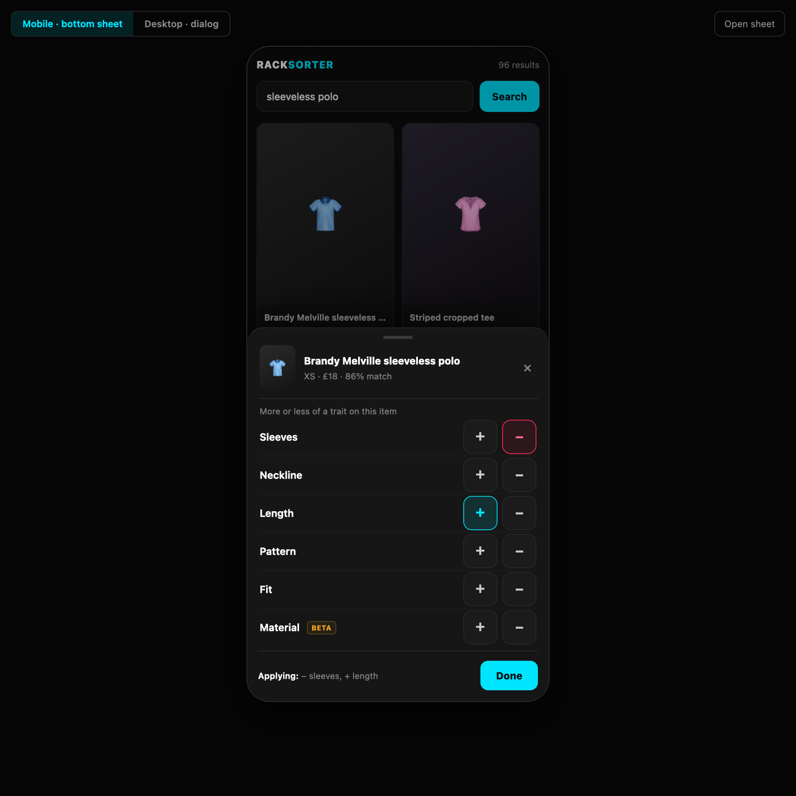
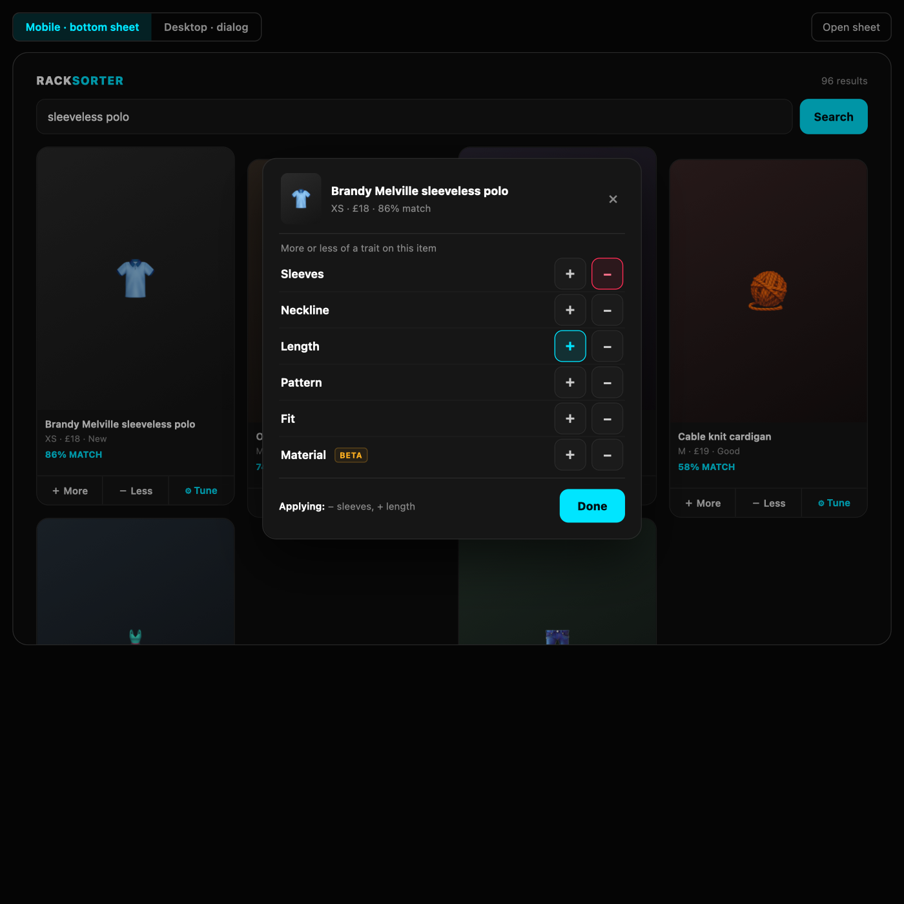

# Trait-aspect feedback: fixed trait vocabulary + CLIP subspace steering

- **Status:** Proposed
- **Date:** 2026-11-11
- **Supersedes:** the dynamic chip design (`extract_relative_feedback_chips` + `apply_text_concept_modifiers`)
- **Related code:** `server/service/{traits,rerank,pool,profile}.py`, `server/service/identifier.py`, `server/service/rank.py`, `server/model/repository/*`, `server/main.py`, `client/src/components/product/{ProductCard,TraitSheet,TraitRadar}.tsx`, `client/src/hooks/useProductSearch.ts`

---

## 1. Problem

"Trait specific" feedback currently has no effect on ranking.

Today `/compare` derives free-text chips by differencing two FashionCLIP image embeddings
(`identifier.extract_relative_feedback_chips`), e.g. `"sleeveless"`, `"flora"`, and the client sends
them back on `/rerank` as `{feedback_type, concept, item_url}`.

`rerank.apply_text_concept_modifiers` then tries to match that string against
`item.characteristics` or `item.description`. Neither attribute exists on `SearchItem`
(`server/dtos.py:5-13`), and nothing populates them. Therefore:

```python
if hasattr(item, 'characteristics') and item.characteristics:   # always False
elif hasattr(item, 'description') and item.description:          # always False
```

`item_has_attribute` is always `False`, `characteristic_modifier` stays `0.0`, and the rank order is
byte-identical to the previous response. The log still prints `[SUCCESS] Concept image feedback computed`.

A previous attempt replaced the text matcher with CLIP subspace steering, but projected a
**DINOv2 768-d** delta onto a **FashionCLIP 512-d** axis, so every comparison raised a shape error that
was swallowed by `try/except` — again a no-op.

Two independent defects must be fixed:

1. **Semantic gap** — the chip label is not connected to any per-candidate signal.
2. **Space mismatch** — aspect axes live in CLIP space; candidates only have DINO vectors.

---

## 2. Goals / non-goals

### Goals

- Trait feedback must measurably reorder results.
- Trait identity is a **closed enum**, not free text.
- No image re-download or model call on the feedback click path.
- Deterministic: reranking the same history twice yields the same order.
- Failure mode is explicit (log/metric), never a silent no-op.

### Non-goals

- Learning weights from implicit behaviour.
- Per-trait model fine-tuning.
- Fixing the session/"current query" state-machine issues in `queries`/`get_query_by_upload_id`
  (tracked separately; see §11).
- Changing the DINO view used for generic "more/less like this" feedback.

---

## 3. Decision

Replace dynamic chips with a fixed trait vocabulary. Each trait is a **signed axis in FashionCLIP
image space**, built once at startup from a prompt pair. Candidates are scored by projection onto that
axis; feedback from a clicked item supplies the *direction*, and `MORE`/`LESS` supplies the *polarity*.

```
axis_a   = normalize( embed(text_pos) − embed(text_neg) )        # 512-d, unit
s_i      = dot( unit(clip_i), axis_a )                           # candidate trait position ∈ [-1, 1]
z_i      = clip( (s_i − mean_pool(s)) / std_pool(s), ±3 )         # pool-relative standing
d        = sign( dot( clicked_clip − anchor_clip, axis_a ) )     # clicked item's direction on this trait
MORE  :  rerank_score_i += w_more · d · z_i
LESS  :  rerank_score_i -= w_less · d · z_i
```

- `clicked_clip` comes from the stored candidate vector (the clicked item is in the pool).
- `anchor_clip` is computed once per request from the uploaded image bytes.
- If the clicked item is exactly neutral on the axis, the direction ties to the positive pole
  (`delta >= 0`); the tap is still applied rather than dropped.
- `mean_pool`/`std_pool` are computed over the *current* candidate pool for that axis, so one weight unit
  is one standard deviation, not one raw CLIP unit (see §5.2).

Rationale for **relative** (clicked-item-derived) direction rather than absolute polarity: with a
sleeveless polo clicked, `LESS sleeve` must mean "toward sleeved", not "toward sleeveless". Absolute
axes cannot express that; the clicked item can.

### Trait vocabulary (v1)

| Key | Axis prompts (positive / negative) | CLIP reliability |
|---|---|---|
| `sleeves` | `"long sleeves"` / `"sleeveless garment"` | strong |
| `neckline` | `"collared buttoned neckline"` / `"open low neckline"` | strong |
| `length` | `"long maxi length garment"` / `"cropped short length garment"` | strong |
| `pattern` | `"floral printed pattern"` / `"plain solid colour"` | strong |
| `fit` | `"oversized loose fit"` / `"tight fitted silhouette"` | medium |
| `material` | `"knitted textured fabric"` / `"smooth woven fabric"` | **weak** — expect noise |

`material` is included behind a flag until subjective eval shows it helps. Labels shown in the UI are
decoupled from keys (`sleeves` → "Sleeves") so copy can change without a migration.

**Colour is deliberately excluded** (decision 2026-11-11):

- the DINO base score is computed on greyscaled images by design, so colour is not represented in the
  ranking the trait would adjust;
- creating a colour axis would mix spaces unless candidates also get the CLIP vector we are already
  storing — the axis alone is not enough;
- explicit colour intent is already handled upstream by the marketplace filters
  (`COLOUR_MAP` → `color_ids[]` in `/fetch_initial`), which is the correct place for it.

If colour-as-trait is wanted later, it should be a separate CLIP-only lane with its own evaluation, not
a member of this vocabulary.

---

## 4. Data model

### 4.1 New column

`search_items` gains a nullable 512-float CLIP image embedding, stored the same way as the existing
DINO vector (float32 BLOB):

```sql
ALTER TABLE search_items ADD COLUMN clip_embedding BLOB;
```

`CREATE_TABLES_QUERY` (`server/model/repository/constants.py`) is updated for fresh databases, and
`service/eval_db.init()` performs the guarded `ALTER` for existing ones:

```python
cols = {row[1] for row in cursor.execute("PRAGMA table_info(search_items)")}
if "clip_embedding" not in cols:
    cursor.execute("ALTER TABLE search_items ADD COLUMN clip_embedding BLOB")
```

### 4.2 Population point

In `service/rank.py::process_and_rank_pool`, the image bytes are already fetched and the DINO pass is
already run per item. Add one FashionCLIP image pass over the same bytes and return/persist the vector:

- no extra network requests;
- ~2–5 s added to a 96-item initial search on this hardware (network was already dominant);
- `insert_search_items` writes `clip_embedding` alongside `embedding`;
- `get_items_by_query_id` / `get_item_by_url` hydrate it.

New `SearchItem` field: `clip_embedding: Optional[List[float]] = None` (kept out of `to_dict`/JSON blob
to avoid doubling blob size — the BLOB column is authoritative).

### 4.3 Backfill

Rows ingested before this change have `clip_embedding = NULL`.

**Decision (2026-11-11): lazy, per query.** On the first trait rerank for a query, encode any missing
vectors in the current result set (≈96 CLIP passes) and write them back, so the cost is paid once and
only by users who actually use trait feedback. Concretely, in `apply_aspect_scores`:

1. select items in the current pool with `clip_embedding IS NULL`;
2. fetch their bytes (`fetch_image_bytes_from_url`) and encode via
   `identifier.get_single_clip_embedding`;
3. persist with a new `update_item_clip_embedding(url, vector)`;
4. proceed with the full pool.

A one-off backfill script over the tracked `search_eval.db` was rejected: the DB is already 85 MB and
committed, and doubling its embedding payload for rows nobody may touch is worse than a first-use cost.

An item that still has no vector after the lazy pass contributes `0` and increments a counter that is
logged with its URL — no silent skip.

---

## 5. Scoring

| Parameter | Value | Rationale |
|---|---|---|
| `w_more` | `0.45` | raised from `0.35`: a tap must visibly reorder the top 10, not just nudge it |
| `w_less` | `0.60` | asymmetric, as before: negative feedback should bite harder |
| `TRAIT_Z_LIMIT` | `3.0` | standardised projection is clipped to ±3σ so one outlier cannot dominate |
| `MIN_TRAIT_SPREAD` | `1e-3` | below this the pool is flat on the axis; the event is skipped and counted |
| per-item cap | `±0.8` summed across all trait events | raised with the weights; still keeps the DINO baseline relevant |

**What the cap means.** Each feedback event adds `±w · d · z_i` (at most ±0.60 for `LESS`) to an item's
`rerank_score`. The history is replayed in full on every rerank, so ten trait clicks would otherwise add
up to ±6.0 and make the DINO similarity irrelevant. The cap clamps the *total* trait contribution per
item to `[-0.8, +0.8]` before sorting:

```python
trait_adjustment = max(-0.8, min(0.8, trait_adjustment))
item.rerank_score = item.rerank_score + trait_adjustment
```

It is applied after the whole feedback fold (not per event), so the ordering of events does not change
the clamp result. It is a single named constant, `MAX_TRAIT_ADJUSTMENT`, so it can be tuned with eval.

Base score is recomputed every request (`compute_base_visual_scores`), then the full feedback history is
folded once. No incremental accumulation across requests, so rerank remains idempotent.

### 5.2 Standardisation against the pool (2026-11-12)

The first implementation folded the **raw** projection `s_i`. Measured on the tracked DB, raw spreads differ
per axis by more than 2×:

| Axis | pool std | z-range of the pool |
|---|---|---|
| `length` | 0.038 | −2.7 … +2.6 |
| `fit` | 0.039 | −2.6 … +2.5 |
| `pattern` | 0.076 | −1.7 … +2.6 |
| `sleeves` | 0.083 | −2.4 … +1.4 |

With `w=0.35`, the strongest possible trait nudge was `0.35 × 0.2 ≈ 0.07`, while base-score gaps between
neighbouring items are typically 0.05–0.15 — so a tap often changed nothing, and the same tap was ~2× weaker
on `length` than on `sleeves`. Candidates are therefore z-scored against the current pool before weighting:

```python
z = clip((s − mean_pool) / std_pool, -TRAIT_Z_LIMIT, TRAIT_Z_LIMIT)
```

Consequences:

- one weight unit now means **one standard deviation of this pool**, so the same tap has comparable
  strength on every axis;
- the adjustment is pool-relative: adding a page of items shifts `mean`/`std`, and the scorer re-derives
  both on every request (nothing is cached across requests);
- a flat axis (`std < MIN_TRAIT_SPREAD`) cannot be standardised; the event is skipped and counted as
  `skipped_degenerate` in the stats line rather than sorting on noise;
- the per-axis pass is cached within one request (`z_cache`), so several taps on the same trait cost one
  pass over the pool.

Measured effect at `w=0.45`: a `MORE sleeves` tap on a sleeveless item moved the top-10 mean sleeves
projection from `−0.01` to `−1.90` **z** (8/10 items changed) without collapsing the DINO ranking.

**Implementation note (2026-11-12): last-write-wins per `(item_url, concept)`.** The original plan folded
contradictory history in timestamp order with no dedupe. In practice the client's `+`/`−` pair maps onto an
append-only history, so `MORE sleeves` followed by `LESS sleeves` on the same item partially cancelled and
left the pool between the two intents — which reads as "my second tap did nothing". The scorer therefore
keeps only the last event per `(item_url, concept)` before folding, and reports the number of superseded
events in the stats line. Switching polarity now reflects final intent exactly; repeated identical taps are
idempotent. Events for *different* items still accumulate (that is how several cards steer the pool), and
the per-item cap is unchanged.

---

## 6. API changes

```python
Trait = Literal["sleeves", "neckline", "length", "pattern", "fit", "material"]

class RerankRequest(BaseModel):
    upload_id: int
    item_url: str
    feedback_type: Literal["MORE", "LESS"]
    concept: Optional[Trait] = None      # now validated, not free text
    fetch_more: bool = True              # pull one extra catalogue page first

class FeedbackEvent(BaseModel):
    item_url: str
    feedback_type: Literal["MORE", "LESS"]
    concept: Optional[Trait] = None

class BatchRerankRequest(BaseModel):
    upload_id: int
    feedback: list[FeedbackEvent]        # everything queued in the sheet
    fetch_more: bool = True

class FetchInitialResponse(BaseModel):
    pool: list[ItemResponse]
    new_items: int = 0                   # items appended by the last rerank's page

class ItemResponse(BaseModel):
    ...
    rerank_score: Optional[float] = None # expose the blended score

class TraitProfileResponse(BaseModel):
    count: int                           # candidates with a CLIP vector
    top_n: int
    mean: dict[str, float]               # pool mean per axis
    std: dict[str, float]                # pool std per axis (the z-scale)
    anchor: dict[str, float]             # uploaded photo, raw projections
    top: dict[str, float]                # mean of the visible top N
    item: Optional[dict[str, float]]     # clicked item, when it is in the pool
```

`POST /rerank_batch` is the path the trait sheet uses: it persists every queued event, fetches one page,
then reranks once. `POST /rerank` remains for a single immediate event (the card's More/Less buttons).
`GET /trait-profile?upload_id=&item_url=` is read-only and replays the same ranking the grid is showing
(§7.2). `GET /health` is a cheap liveness probe. `fetch_more=false` exists so offline replays/tests can
skip the scrape without changing the feedback path.

- Rejecting unknown concepts at the edge prevents "sleeveless"/"flora" reaching the scorer again.
- `rerank_score` is needed for the UI to show that ranking changed; `ProductCard` currently renders
  `similarity_score`, which is frozen at ingest time.
- SQLite `CHECK` constraint on `rerank_feedback.concept` is optional; enforcing it requires a table
  rebuild. API validation + a service-level assertion is sufficient for v1 — note this if the DB is
  ever consumed by another writer.

`/compare` and `extract_relative_feedback_chips` become dead in the UI path. v1 keeps the endpoint for
debugging but the client no longer calls it; a follow-up removes it and regenerates `api.d.ts`.

---

## 7. Client changes

**Decision (2026-11-11): fixed traits replace dynamic chips.** `/compare` leaves the UI path entirely;
there is no "suggested differences" row and no per-card async fetch. The trait set is a static list from
the shared enum.

### Mobile-first surface

Rendering six traits × two actions inline would add twelve tap targets to every card, push the masonry
grid apart and be unusable one-handed. Instead:

- each `ProductCard` gets **one** button ("Tune" / sliders icon) in the existing action row;
- tapping it opens a **menu modal** listing the traits, each with a `+` / `−` pair;
- the backdrop is a **translucent scrim** (e.g. `rgba(0, 0, 0, 0.35)`), optionally with
  `backdrop-filter: blur(2px)`, so the product images stay visible behind and the user keeps context;
- on phones it presents as a bottom sheet (full width, rounded top, thumb-reachable, 44 px targets,
  safe-area padding); on desktop the same component is a centred dialog;
- tapping `+`/`−` only updates local state: the sheet queues several trait adjustments, and
  **Done** sends them together as one `POST /rerank_batch` (one page fetch, one rerank, one grid
  refresh). Closing without Done sends nothing;
- the modal owns the "which item am I tuning" context (thumbnail + title in the sheet header), which
  the current inline chips do not show once the card scrolls.

`ProductCard` no longer needs `characteristics` or `comparisonLoadingMap`; `useCompareItem` and the
`/compare` call are removed. The sheet's open/closed state belongs in `useUIState` (or a new
`useTraitSheet`), keyed by item URL, not in per-card state.

Accessibility: `role="dialog" aria-modal="true"`, labelled by the item title, focus moved to the sheet on
open and returned to the Tune button on close, `Escape` closes, scrim click closes, `aria-pressed` on
each `+`/`−`, and `prefers-reduced-motion` skips the slide/scale.

### 7.1 Fetch more on every feedback (2026-11-12)

A trait tap only reorders what is already in the pool, so feedback on a small pool converges quickly: the
top 10 soon contains every item that fits the requested direction. Every feedback request (the card's
single `/rerank` or the sheet's `/rerank_batch`) therefore scrapes **one extra Vinted catalogue page**
and merges it into the same `query_id` before scoring:

- the stored `query_params` from `/fetch_initial` are reused with `&page=N`; an in-process cursor starts at
  `2` and advances per upload, capped at `MAX_PAGE=8`;
- the new page is deduped by URL against the rows already stored, so a restart that replays a page adds
  nothing;
- new rows go through the normal `process_and_rank_pool` path, including the ingest-time CLIP vector, so
  they are immediately eligible for trait scoring;
- `/fetch_initial` resets the cursor, so a new search starts from page 2 again;
- `new_items` is returned to the client and shown in the sheet footer (`+N new items from a wider search`);
- the scrape is **fail-soft at the call site**: a blocked/slow page is logged and the rerank proceeds on
  the existing pool. The feedback itself is already persisted before the scrape, so it is never lost.

Cost: 2–10 s per tap on this connection, plus embeddings for the new rows. That is why the sheet shows
`Updating results…` and card actions are disabled while the request is in flight.

### 7.2 Trait-axes debug view (2026-11-12)

The scorer's behaviour is hard to reason about from rank order alone, so the sheet has a collapsible
`▸ Trait axes` panel (marked **debug**). It draws a hexagon with one spoke per trait and three shapes:

| Shape | Meaning |
|---|---|
| dashed grey | the uploaded anchor photo |
| solid cyan | mean profile of the visible top `n` (what the ranking currently prefers) |
| dotted amber + dots | the clicked item, when it is in the pool |

Values use the scorer's own z-scale: `z = (s − pool mean) / pool std`, clipped to ±3. The **centre is
−3σ**, the dashed middle ring is the pool mean (`z=0`), and the outer edge is `+3σ`; each point stays on
its own spoke, so sign is read as inward/outward from the mean ring. This makes the diagram directly
comparable to the weight: a shape pushed to the outer edge is receiving the full `MAX_TRAIT_ADJUSTMENT`
on that axis.

The client fetches `/trait-profile` when the sheet opens (baseline) and **again after every rerank**,
passing the clicked URL, so the top polygon and the mean/std scale visibly move with each tap. Profile
failures never fail the search; the panel renders the backend reason instead of disappearing silently.

### Other client work

- Match badge prefers `rerank_score ?? similarity_score`.
- `ProductGrid.handleFeedbackAndScroll` currently scrolls the grid to the top on every feedback event;
  with the sheet that is jarring. Scroll-to-top should happen only on dismiss, or not at all.


### Mockup

Open [`trait-sheet-mockup.html`](./trait-sheet-mockup.html) in a browser (no build step, no assets). The
toolbar toggles the mobile phone frame and the desktop layout, and "Open sheet" shows the interaction;
`+`/`−` are mutually exclusive per trait, tapping the active one clears it, and the footer summarises
what would be sent. The mockup is a visual reference: the shipped sheet sends `MORE`/`LESS` to an
append-only history (last-write-wins server-side), so the active button is inert rather than clearing.

| Mobile — bottom sheet | Desktop — centred dialog |
|---|---|
|  |  |

---

## 8. Verification

Unit (`server/tests/service_tests/test_traits.py`; the scoring fold is injected with synthetic 2-d axes and
vectors so no model loads):

- axis vectors exist for every trait and are unit-normalised, built from the prompt pairs (the CLIP text
  encoder is injected);
- an item aligned with the sleeves axis outranks an anti-aligned item after `MORE sleeves`;
- `LESS sleeves` inverts that order;
- a clicked item exactly on the anchor still applies, with the neutral direction tying to the positive pole;
- rerank with no feedback leaves scores untouched;
- switching polarity uses the last choice per `(item_url, concept)`;
- the per-item cap clamps the folded total;
- feedback strength is **pool-relative**: a wide-spread pool and a narrow-spread pool produce identical
  score deltas at ±1σ (`test_adjustment_is_pool_relative_not_raw_projection`);
- a flat axis is skipped and reported as `skipped_degenerate` instead of sorting on noise;
- regression: a DINO vector in the CLIP slot raises `dimension mismatch` rather than being swallowed.

`test_pool.py` covers fetch-more: unseen-only merge, page cursor advance (`page=2`, `page=3`), the page cap,
missing query params, and a duplicate page that adds no rows but still advances the cursor.

`test_profile.py` covers the debug payload: pool mean/std, anchor and top polygons, clicked-item inclusion,
the failure when no candidate has a vector, and that the profile replays the stored feedback history.

Repository tests cover the `clip_embedding` column (hydrate/insert/update), the guarded migration, the
`ORDER BY id DESC` query lookup, and `get_item_urls_for_query` (the fetch-more dedupe source).

Integration: seed a query with synthetic 512-d vectors, post `/rerank` twice, assert identical output
(idempotency) and that ordering differs from `/fetch_initial`.

Manual: use the tracked `search_eval.db` to replay a fixed upload (e.g. upload 32, 96 items) and diff
rank order between baseline and each trait.

Tests must not depend on loading real models; inject axis/candidate vectors (the suite runs in ~3 s and
never touches torch).

Measured on the tracked DB after implementation: a 512-d unit axis per trait, 96/96 vectors warm at ingest,
and an A/B trait event on a 266-item pool flipped the top-10 sleeves projection from `+0.0045` (MORE) to
`+0.0487` (LESS) with 8/10 overlap — the ranking moves in the intended direction without collapsing.

---

## 9. Performance

| Path | Added cost |
|---|---|
| `/fetch_initial` | 1 extra CLIP forward per item (same bytes already fetched) |
| `/rerank` (trait event, vectors warm) | 1 more catalogue page (2–10 s + downloads), 1 anchor CLIP forward, O(n) dot products |
| `/rerank` (trait event, **first** for a cold query) | ~96 image downloads + ~96 CLIP forwards, then write-back (§4.3) |
| `/trait-profile` | re-reads the pool and replays the fold; no network once vectors are warm (<50 ms) |
| `/compare` | removed from UI path |

Fetch-more dominates every tap. It is intentionally on the feedback path (not a background job) because
the new page must be ranked with the feedback that triggered it; a blocked page degrades to "rank the
existing pool" rather than failing the tap (§7.1).

With warm vectors, rerank stays in the low milliseconds of CPU work and the anchor encode dominates
(~50 ms). The cold path does not: because only image URLs are stored (not bytes), the lazy backfill must
**re-download** the pool before it can encode it. At 96 items that is tens of seconds on a slow
connection — far too long to sit behind a `+` tap with no feedback.

### 9.1 Warming the vectors

**As implemented (2026-11-12), no background task is needed.** Because §4.2 encodes every candidate during
`/fetch_initial` (the bytes are already in memory), a query's vectors are warm as soon as the grid appears.
Measured on the tracked DB: a 96-item pool is fully encoded at ingest, so the first `⚙ Tune` costs one
anchor CLIP forward plus dots and stays in the low seconds; only rows that predate the column take the cold
path (measured 85 s for 244 legacy items, 2.9 s once warm).

The synchronous lazy pass in §4.3 remains as the correctness fallback: if a trait event arrives while
vectors are still missing, it encodes **only the missing ones**, under a per-upload lock, and the sheet
shows a pending state for that request instead of a silent freeze.

Two consequences to design for:

1. **Concurrency.** Two tabs, or a second upload, must not start two passes over the same rows. The lazy
   pass is guarded by an in-process lock per upload; a second request waits or proceeds with the vectors
   already present.
2. **Partially warm.** Scoring must not depend on the whole pool being encoded. Items without a vector
   contribute `0` and are counted/logged (§4.3), so an early tap yields a weaker but correct rerank
   rather than a failure.

If ingest-time encoding ever becomes too slow for `/fetch_initial`, the deferred alternative is the
background warm-up considered originally: schedule the CLIP pass after the response returns
(`BackgroundTasks` or one worker thread) and write vectors back as each item completes. That adds
concurrency the codebase has no machinery for, so it was not implemented.

---

## 10. Risks

- **Weak traits** (`material`) may produce visibly random ordering. Mitigate with the flag and eval.
- **Colour is out of scope** (see §3): do not be tempted to reuse the DINO vector for a colour axis —
  it is greyscaled, so any colour signal derived from it would be noise.
- **Overlay interaction cost**: trait feedback becomes an extra tap plus a dismiss. If eval shows usage
  collapsing, consider inline chips on desktop only (≥768 px) and the sheet on mobile.
- **Cold storage growth**: 96 × 512 × 4 B ≈ 200 KB per query; acceptable, but the tracked SQLite file
  grows and will need pruning or Git LFS/`.gitignore` treatment.
- **Two embeddings per item** doubles the chance of hydrating the wrong one; keep names explicit
  (`embedding` = DINO, `clip_embedding` = CLIP) and assert dimensions at load (the scorer raises a
  named `dimension mismatch` error rather than letting `dot()` fail opaquely).
- **Silent failure recurrence**: any `try/except` in the scoring loop must increment a counter and log
  `concept`, `item`, and vector sizes; a no-op must be observable.
- **Two embeddings per item** doubles the chance of hydrating the wrong one; keep names explicit
  (`embedding` = DINO, `clip_embedding` = CLIP) and assert dimensions at load.

---

## 11. Decisions and open questions

### Resolved (2026-11-11)

| Question | Decision |
|---|---|
| Colour as a trait? | **No** — removed from the vocabulary; colour stays in marketplace filters (§3). |
| Backfill strategy | **Lazy, per query**, with write-back (§4.3). |
| Dynamic chips vs fixed traits | **Fixed traits replace dynamic chips.** `⚙ Tune` on each card opens a menu modal with a translucent scrim so images stay visible (§7). |
| Stale-query defect | Tracked separately in [`docs/defects/stale-query-selection.md`](../defects/stale-query-selection.md); it must land before trait evaluation is meaningful. |

### Still open

1. Keep `material`, or ship the five structural traits first (`sleeves`, `neckline`, `length`,
   `pattern`, `fit`)?

### Resolved (2026-11-12, during implementation)

| Question | Decision |
|---|---|
| Contradictory history | **Last-write-wins per `(item_url, concept)`** (§5), replacing "no dedupe". The client's `+`/`−` pair writes to an append-only log, so superseding is what the user means. |
| Background warm-up | **Not implemented.** Vectors are written at ingest (§4.2), so a fresh search is already warm; the lazy pass only serves legacy rows (§9.1). |
| Sheet after a tap | **Queues locally.** `+`/`−` only change the sheet; tapping **Done** sends the whole selection in one batch (one fetch, one rerank, one refresh). Closing without Done sends nothing. Choices are kept per item URL, so reopening the sheet reflects what is already applied and the card's trigger shows an active state. |
| Tapping the active `+`/`−` | **No clear.** The history is append-only, so the active button is inert and the opposite polarity is sent instead. This differs from `trait-sheet-mockup.html`, which still shows tap-to-clear; the mockup is kept as the visual reference only. |
| Feedback strength | **Raised + standardised.** `w_more=0.45`, `w_less=0.60`, cap `0.8`, and raw projections are z-scored against the current pool (§5.2). Raw projections made the same tap ~10× weaker than intended and axis-dependent. |
| Fetch on feedback | **Yes.** Every feedback request pulls one extra catalogue page before scoring (§7.1), merges unseen URLs, and reports `new_items`. Batching on Done means one fetch for the whole sheet. Fail-soft: a blocked page never eats the feedback. |
| Visualising the axes | **Collapsible debug hexagon** in the sheet (§7.2), refetched after every feedback. Centre = −3σ, mean ring = pool mean, edge = +3σ. |


---

## 12. Alternatives considered

| Alternative | Why rejected |
|---|---|
| Match concept against `item.title` only | Free and would work for 29/96 items today, but wording-dependent and not a trait model. Kept as a fallback/stopgap. |
| Absolute axis polarity (`LESS sleeve` = "more sleeveless") | Contradicts user intent when the clicked item is itself sleeveless. |
| Reuse DINO vectors for projection | Text axes exist only in CLIP space; 768↔512 mismatch is what caused the previous no-op. |
| Per-candidate zero-shot tag storage instead of embeddings | Coarser (loses continuous magnitude) and still needs the same CLIP pass; usable as a debugging aid. |
| Text-rule scoring on a populated `characteristics` field from Vinted metadata | No such field is scraped today (scraper returns title/url/image_url only); would require scraping item detail pages. |
