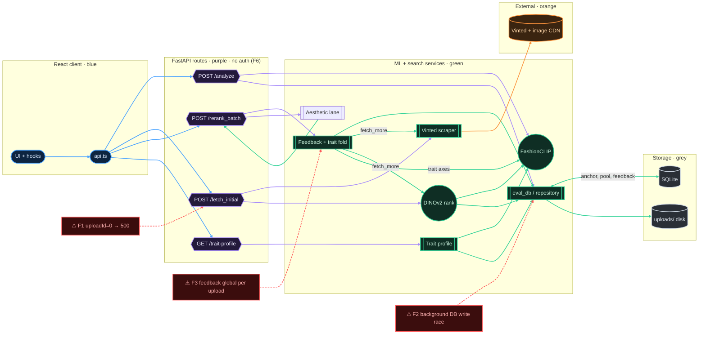
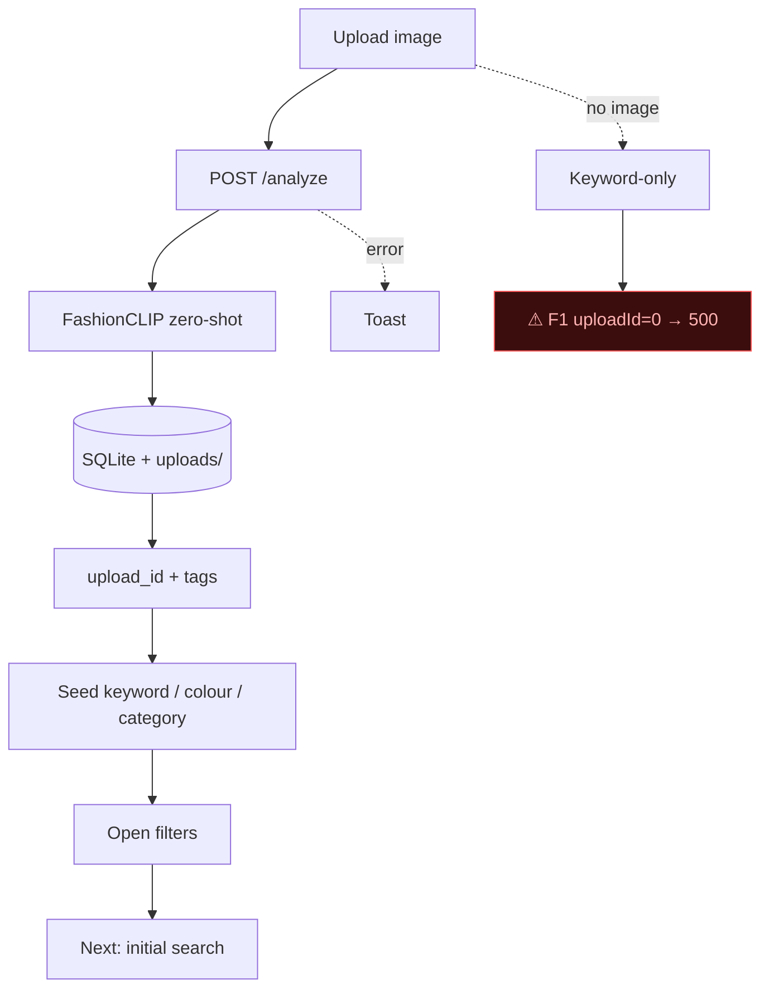
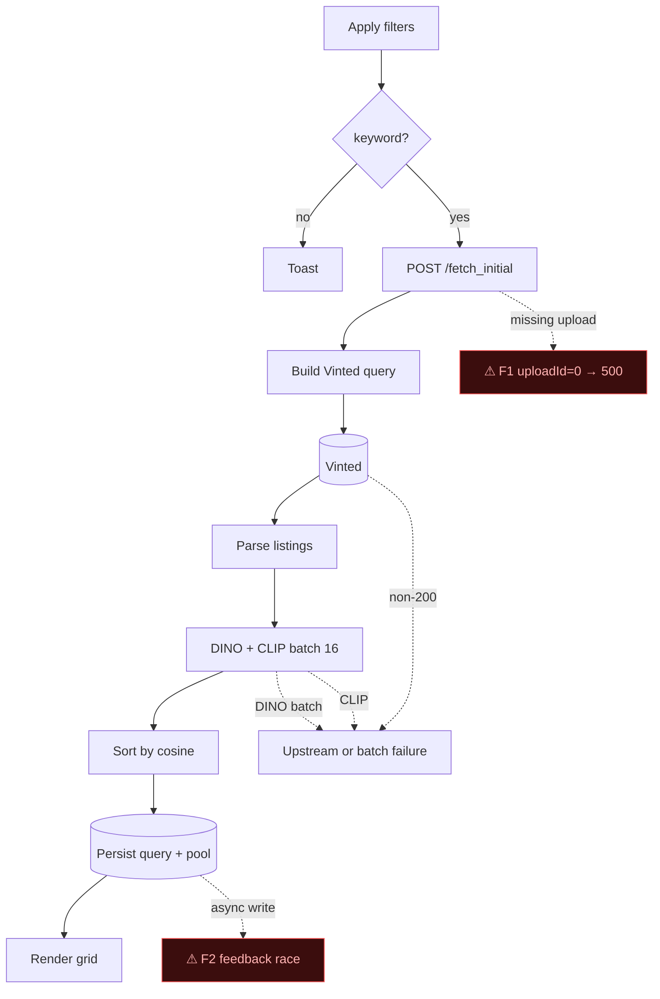
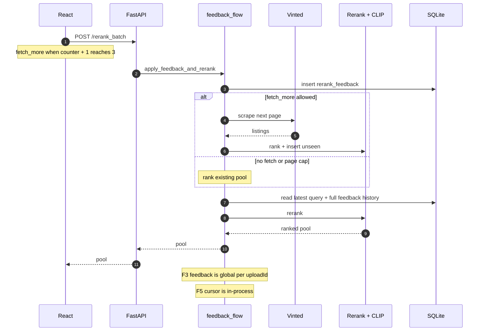
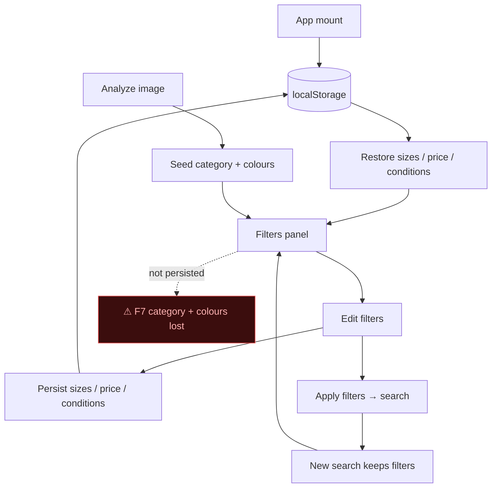

# Living E2E flow diagrams

Current system behavior, one visual layer per section. If the code and a diagram disagree, treat that as drift and fix it in the same task.

Last verified: **2026-11-20** against commit `fc03240` — Alembic owns the SQLite schema and applies it in `lifespan`; `new_items` dropped from the `/fetch_initial` and `/rerank_batch` responses and the client hook.

## System map

How the browser, API, services, external systems, and shared state connect. **Routes never touch SQLite**; every read/write goes through the green service layer. Edge colours show the caller: blue = browser, purple = route → service, green = service → service/storage, orange = external fetch, red dashed = fault. Shapes: stadium = client entry, hexagon = HTTP route, subroutine = service, circle = ML model, cylinder = datastore/source.



## Flow index

| Flow | Entry points (client → server) | Related faults | E2E spec |
| --- | --- | --- | --- |
| [01: Image analysis](#flow-01-image-analysis-and-search-seeding) | `SearchActionBar.tsx`, `App.tsx`, `useImageAnalysis.ts`, `api.ts` → `routes/analyze.py`, `identifier.py`, `eval_db.py` | F1, F6 | **None** |
| [02: Initial search](#flow-02-filtered-initial-search) | `PreferencesPanel.tsx`, `useProductSearch.ts`, `api.ts` → `routes/search.py`, `scraper.py`, `rank.py`, `eval_db.py` | F1, F2 | **None** |
| [03: More / Less feedback](#flow-03-more--less-feedback) | `ProductCard.tsx`, `useProductSearch.ts`, `api.ts` → `routes/search.py`, `feedback_flow.py`, `pool.py`, `rerank.py` | F3, F5 | **None** |
| [04: Trait tuning + style strip](#flow-04-trait-tuning-tune-sheet) | `StyleStrip.tsx`, `TraitSheet.tsx`, `App.tsx`, `useProductSearch.ts`, `useTraitProfile.ts`, `api.ts` → `routes/search.py`, `profile.py`, `trait_scoring.py`, `aesthetic_scoring.py` | F3, F9 | **None** |
| [05: Preferences & session](#flow-05-preferences-and-session-state) | `useFilters.ts`, `useUIState.ts`, `App.tsx`, `PreferencesPanel.tsx`, `ActiveFiltersSummary.tsx` | F7 | **None** |

Path shorthand: client files are under `client/src/`, server route/service files under `server/`, and test paths under `server/tests/`.

## Flow 01: Image analysis and search seeding

Upload a reference photo, turn it into search-ready signals, and seed the filter panel.



**Gotchas & rules**

- `upload_id` exists only after a successful `/analyze`; the filter panel auto-opens when suggestions arrive.
- Keyword-only search is not supported: the client sends `0`, and `/fetch_initial` cannot load an anchor (**F1**).
- Uploaded files are stored on disk but are not publicly served; the preview is a local `FileReader` URL.
- There are no auth or ownership checks anywhere (**F6**).

## Flow 02: Filtered initial search

Turn the reference image plus keyword/filters into a ranked, persisted candidate pool.



**Gotchas & rules**

- Filters become Vinted query params; `See all` adds no category constraint.
- DINOv2 cosine similarity ranks the pool; FashionCLIP vectors are computed at ingest for later trait steering.
- The DB write is a background task, so feedback sent immediately after the grid appears can race it (**F2**).
- Vinted non-200 → 502. Failed image downloads skip that item; DINO runs in batches of 16 and one bad image drops the whole batch, while an uncaught CLIP batch error fails the request (500).

## Flow 03: More / Less feedback

One card tap reranks immediately; every third tap also pulls one more catalogue page.



**Gotchas & rules**

- One tap = one event with `concept: null`; the client resets its counter whenever it asks for a page, even if zero items arrive.
- Page fetch is fail-soft: failures rank the existing pool; the in-process cursor walks pages 2–8.
- The server replays the **entire feedback history for the upload**, not the latest event or the current query (**F3**).
- The page cursor does not survive a restart (**F5**).

## Flow 04: Trait tuning (Tune sheet) + style strip

Steer results along fixed physical traits via the Tune sheet, or absolute free-text style phrases via the global StyleStrip; inspect the debug radar.

```mermaid
sequenceDiagram
    autonumber
    participant UI as StyleStrip + TraitSheet
    participant API as FastAPI
    participant P as profile
    participant ML as CLIP + scorer
    participant DB as SQLite

    UI->>API: GET /trait-profile
    API->>P: build_trait_profile
    P->>DB: anchor + pool
    P->>ML: ensure CLIP vectors, project axes
    alt vectors available
        ML-->>P: mean / std / anchor / item
        P-->>API: profile
        API-->>UI: profile
    else missing anchor or CLIP vector
        P-->>API: 500
        API-->>UI: 500 → axes unavailable
    end
    Note over P: F9 profile 500 → axes unavailable
    Note over UI: StyleStrip: tap chip → POST /rerank_batch now
    UI->>API: POST /rerank_batch (aesthetic events)
    API->>ML: rerank: aesthetic lane
    ML-->>API: ranked pool
    API-->>UI: pool
    Note over API: F3 events share upload-global history
    Note over ML: aesthetic: last write wins per phrase; absolute (no clicked item)
    Note over UI: Tune sheet: queue physical picks; Done → POST /rerank_batch
    UI->>API: POST /rerank_batch (trait events)
    API->>ML: rerank: trait fold
    ML-->>API: ranked pool
    API-->>UI: pool
    Note over ML: physical: last write wins per item + concept
```

**Gotchas & rules**

- Closed vocabulary: `sleeves`, `neckline`, `length`, `pattern`, `fit`; unknown concepts fail validation. Aesthetic events carry a free-text `aesthetic` phrase (new `rerank_feedback.aesthetic` column); the aesthetic lane is absolute — direction comes from the phrase, not the clicked item.
- The strip reranks immediately on tap (no queue): tapping an active chip off sends `LESS`, which removes the phrase; a later `MORE` re-enables it.
- The sheet queues physical picks locally and sends them on **Done**; no picks simply closes.
- Last write wins per `(item_url, concept)` for physical events and per phrase for aesthetic events. Physical projections are clipped to ±3, weighted `0.45` / `0.60`; aesthetic adjustments use `W_AESTHETIC = 0.45`; both share the ±0.8 per-item clamp. When the last aesthetic phrase is removed, the lane leaves the pool untouched — the base scores stand.
- Physical and visual lanes stay separate: aesthetic events never feed the visual intent vector; flat axes, blank phrases and missing CLIP vectors skip the event (physical and aesthetic share the spread/skip policy). A profile failure only disables the debug axes (**F9**).

## Flow 05: Preferences and session state

What filter state survives analysis, searches, and reloads.



**Gotchas & rules**

- Sizes, price, and conditions persist in `localStorage`; category and colours do not (**F7**).
- Analysis can overwrite a category/colour chosen before the upload.
- A new search keeps filters but clears results, trait picks, the fetch counter, and the profile.
- `ActiveFiltersSummary` receives App's live filter state as a prop, so it tracks in-session edits.

## Integration & fault map

### HTTP surface

| Method | Path | Handler | Client caller | Notes |
| --- | --- | --- | --- | --- |
| `GET` | `/health` | `api/routes/health.py` | none | Cheap liveness probe. |
| `POST` | `/analyze` | `api/routes/analyze.py` | `analyzeFile` | Multipart file; persists upload + CLIP tags. |
| `POST` | `/fetch_initial` | `api/routes/search.py` | `fetchInitial` | Scrapes, ranks, returns pool; DB write is async. |
| `POST` | `/rerank` | `api/routes/search.py` | none | Legacy single-event endpoint. |
| `POST` | `/rerank_batch` | `api/routes/search.py` | `rerankBatch` | Current client feedback path. |
| `GET` | `/trait-profile` | `api/routes/search.py` | `fetchTraitProfile` | Debug projections; needs anchor + candidate CLIP vectors. |
| `GET` | `/` | `server/main.py` | browser | Returns `index.html` from the server working directory. |
| `GET` | `/manifest.json` | `server/main.py` | browser | Returns `manifest.json` from the server working directory. |
| `GET` | `/assets/*` | `server/main.py` | browser | Mounted only when `dist/assets` exists. |

No auth, sessions, tokens, or ownership checks exist. Upload IDs are sequential integers accepted from the client (**F6**).

### External boundaries

| Boundary | Used by | Failure behaviour |
| --- | --- | --- |
| Vinted catalog HTML | `service/scraper.py` via `curl_cffi` | Non-200 → `502`. |
| Vinted image CDN | `service/rank.py`, `service/clip_vectors.py` via `cloudscraper` | Failed downloads skip the item; a DINO batch error drops up to 16 items; an uncaught CLIP error returns 500. |
| DINOv2 (`facebook/dinov2-base`) | `service/rank.py` | Lazy-loaded singleton. |
| FashionCLIP (`patrickjohncyh/fashion-clip`) | `service/identifier.py`, `service/traits.py` | Lazy-loaded singleton; builds concept/axis embeddings. |
| SQLite (`search_eval.db`) | `model/repository/*`, `service/eval_db.py` | Schema applied by Alembic in `lifespan`; no hand-written DDL in app code. |
| Upload disk (`service/static/uploads`) | `service/eval_db.py`, `service/repository.py` | Missing file → 500 on ranking/profile paths. |

### Fault map

Grouped by what the user experiences. Fault IDs match the red markers, layer annotations, and `Note over` labels in the diagrams.

| ID | Area | What breaks | Fix direction |
| --- | --- | --- | --- |
| **F1** | Search & upload | Keyword-only search sends `uploadId: 0`; `/fetch_initial` 500s | Require an analyzed upload, or support keyword-only search with a text anchor. |
| **F2** | Search & upload | `/fetch_initial` returns before `save_query_to_db`; immediate feedback can 500 | Await the write or return a query ID the client sends back. |
| **F3** | Feedback & ranking | Feedback is global per `upload_id`; a new search inherits old feedback | Scope feedback to `(upload_id, query_id)`. |
| **F5** | Feedback & ranking | Page cursor is in-process and capped at page 8 | Persist the cursor or document single-process behavior. |
| **F6** | Security | No auth/ownership checks; upload IDs are enumerable | Add session/ownership checks before any multi-user deployment. |
| **F7** | Persistence & state | Category and colours are lost on reload | Persist them like sizes/price/conditions. |
| **F9** | Feedback & ranking | `/trait-profile` 500s when CLIP vectors are missing; legacy backfill is synchronous | Backfill at ingest or async; keep the axes-unavailable fallback. |

## Verification & harness

The rule lives in `AGENTS.md`, so it is applied to every prompt. CI has one narrow check: a PR that changes `server/api/`, `server/main.py`, or `client/src/api.ts` must also change this file. It is a coupling proxy, not a diagram validator; keeping the diagrams accurate is still the agent's job. This file owns system truth only.

Run the repository checks:

```bash
cd server && .venv/bin/python -m ruff check . && .venv/bin/python -m pytest tests -q
cd client && npm run lint && npm run typecheck && npm run build
```

There is **no browser E2E suite**. The closest automated coverage is HTTP validation and service-level unit tests:

| Flow | Closest automated coverage |
| --- | --- |
| 01 | `tests/api_tests/test_smoke.py::test_analyze_requires_a_file` |
| 02 | `test_smoke.py::test_fetch_initial_validates_required_fields`, `test_rank.py`, `test_scraper.py`, repository tests |
| 03 | `test_smoke.py::test_rerank_batch_validates_required_fields`, `test_pool.py`, `test_rerank.py`, `test_feedback.py` |
| 04 | `test_smoke.py::test_trait_profile_requires_upload_id`, `test_profile.py`, `test_traits.py`, `test_rerank.py`, `test_aesthetic_scoring.py` |
| 05 | None (client has no test runner) |

<details>
<summary>Manual UI smoke checklist</summary>

1. Start server on `:8000` and client on `:3000`.
2. Upload an image → suggestions appear; filters auto-open.
3. Apply filters → ranked grid + active-filter summary.
4. Tap More/Less twice → rerank without a page fetch; counter decrements.
5. Tap a third time → fetch + rerank; counter resets.
6. Open Tune → radar loads; queue traits → Done → rerank, picks persist, sheet closes.
7. Reopen Tune for the same item → applied picks are mirrored.
8. Style strip → below the filters: tap a chip → pool reranks, chip becomes active (✕);
   tap again → removed; "＋ more" reveals the preset list + free-text field.
9. Stop the backend and retry → toast/sheet error path.

Record which steps actually ran. Do not claim an E2E pass from unit tests alone.

</details>
