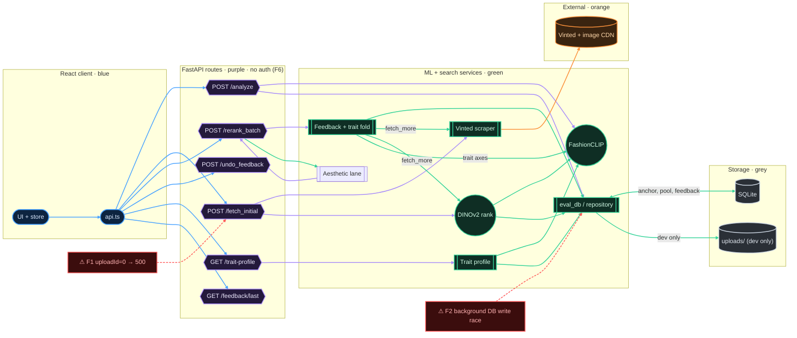
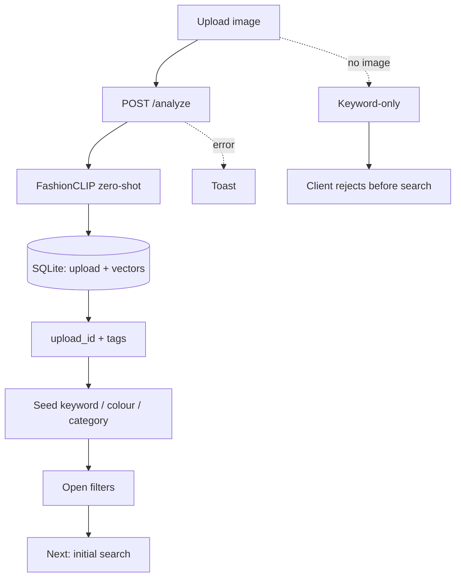
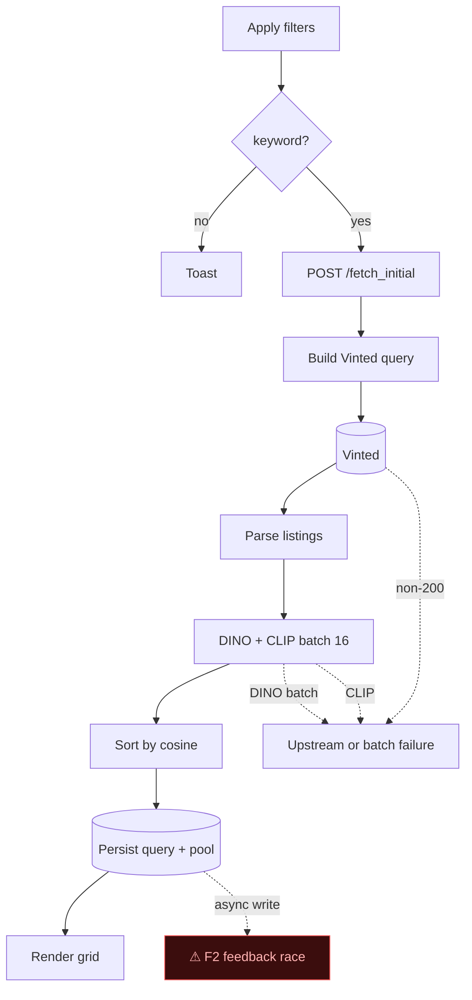
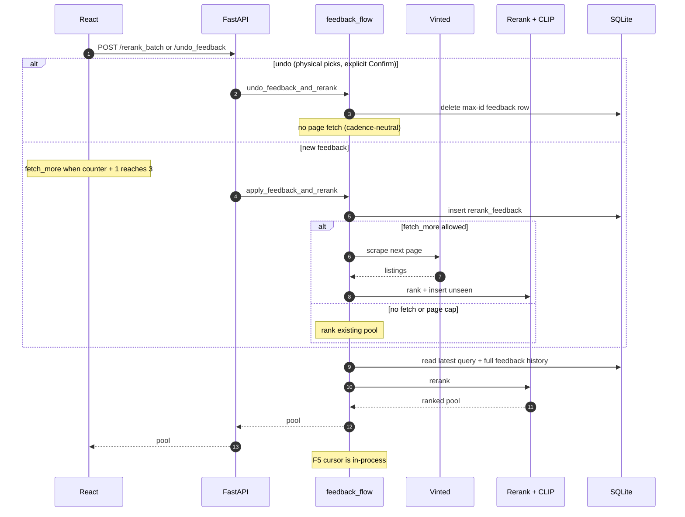
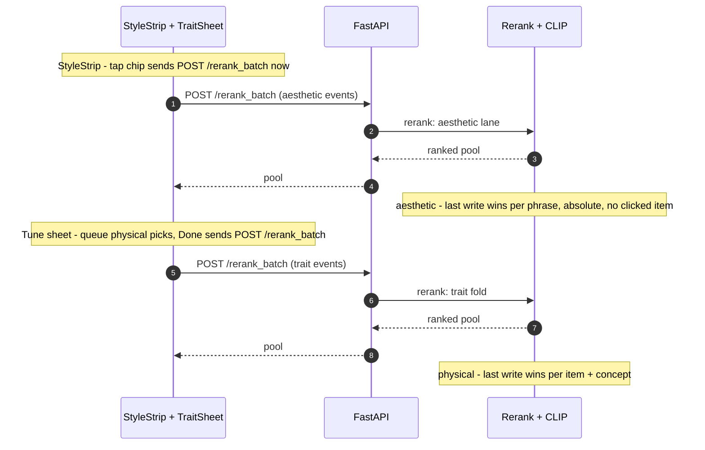
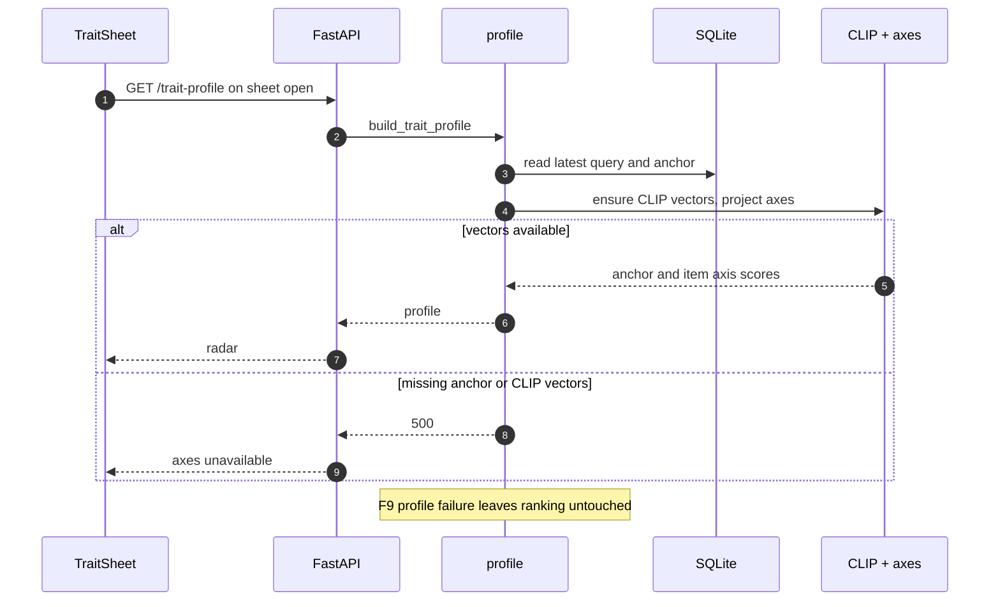
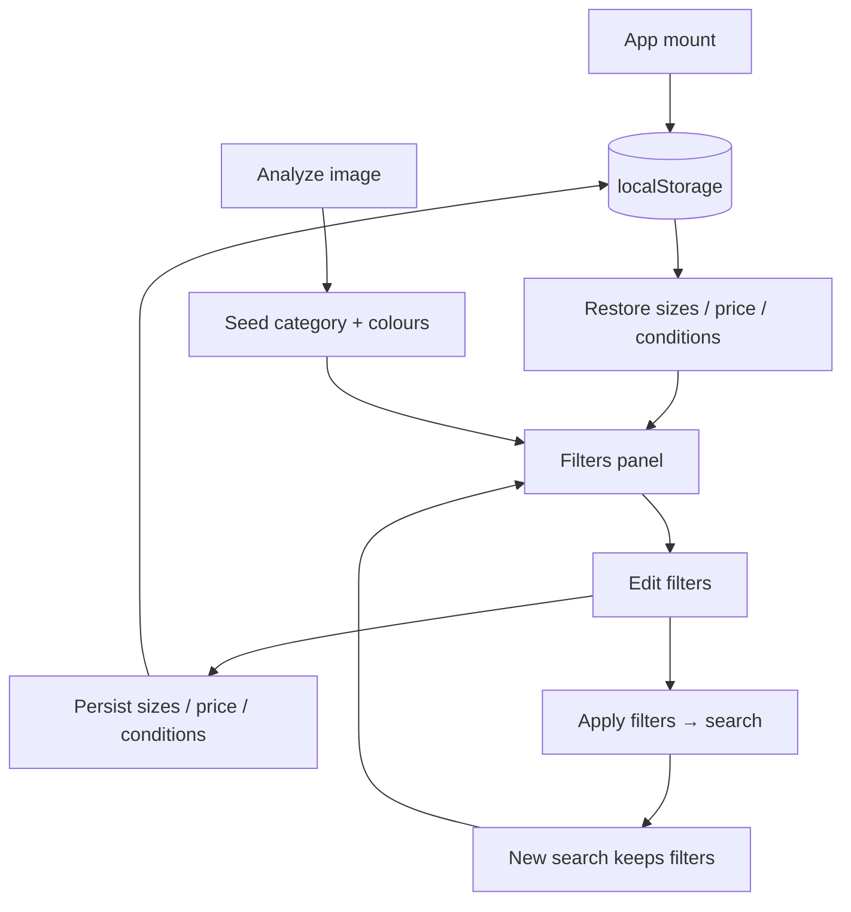

# Living E2E flow diagrams

Current system behavior, one visual layer per section. If the code and a diagram disagree, treat that as drift and fix it in the same task.

Last verified: **2026-11-25**, working tree at `19bf37c`.

## System map

How the browser, routes, services, external systems and storage connect. Routes never touch SQLite; reads and writes go through services. Edge colours: blue = browser, purple = route → service, green = service → service/storage, orange = external fetch, red dashed = known limitation. Shapes: stadium = client entry, hexagon = route, subroutine = service, circle = ML model, cylinder = datastore/source.



## Flow index

| Flow | Entry points (client → server) |
| --- | --- |
| [01: Image analysis](#flow-01-image-analysis-and-search-seeding) | `SearchActionBar.tsx`, `App.tsx`, `state/commands.ts`, `api.ts` → `routes/analyze.py`, `identifier.py`, `eval_db.py` |
| [02: Initial search](#flow-02-filtered-initial-search) | `PreferencesPanel.tsx`, `state/commands.ts`, `api.ts` → `routes/search.py`, `scraper.py`, `rank.py`, `eval_db.py` |
| [03: More / Less feedback](#flow-03-more--less-feedback) | `ProductCard.tsx`, `App.tsx` (undo bar), `state/commands.ts`, `api.ts` → `routes/search.py`, `feedback_flow.py`, `pool.py`, `rerank.py` |
| [04: Trait tuning + style strip](#flow-04-trait-tuning-tune-sheet) | `StyleStrip.tsx`, `TraitSheet.tsx`, `state/commands.ts`, `api.ts` → `routes/search.py`, `feedback_flow.py`, `rerank.py`, `trait_scoring.py`, `aesthetic_scoring.py` |
| [05: Trait profile](#flow-05-trait-profile) | `TraitSheet.tsx`, `App.tsx`, `state/commands.ts`, `api.ts` → `routes/search.py`, `profile.py`, `rerank.py` |
| [06: Preferences & session](#flow-06-preferences-and-session-state) | `state/store.tsx`, `state/persistence.ts`, `App.tsx`, `PreferencesPanel.tsx`, `ActiveFiltersSummary.tsx` |

Path shorthand: client files are under `client/src/`, server route/service files under `server/`, test paths under `server/tests/`. There are no browser E2E specs; the closest automated coverage is listed under Verification.

## Flow 01: Image analysis and search seeding

Upload a reference photo, turn it into search-ready signals, and seed the filter panel.



**Gotchas & rules**

- `upload_id` is created by `/analyze` and arrives with suggestions and the filter panel. Uploads are single-flight — the picker is disabled during analysis. One image = one `upload_id` = one session.
- Tag and colour suggestions are deduplicated before display; the archetype is also the first classified tag.
- Chip highlight follows `confirmedKeyword`. A new upload clears suggestions and can reopen the filter panel.
- Accepted uploads are images up to 10 MB; the picker supports re-selecting the same file.
- A search needs an analyzed upload; the client rejects keyword-only input before a request. Direct `/fetch_initial` calls with `uploadId: 0` return 500 (F1).
- API errors reach the user with the server's detail.
- Only the anchor's DINO and FashionCLIP vectors are stored by default. The image file is written only with `RS_SAVE_UPLOAD_IMAGES=1` (dev), is never publicly served, and the preview is a local `FileReader` URL. Ranking and trait steering use the stored vectors.
- There are no auth or ownership checks (F6).

## Flow 02: Filtered initial search

Turn the reference image plus keyword/filters into a ranked, persisted candidate pool.



**Gotchas & rules**

- Filters become Vinted query params; `See all` adds no category constraint.
- The scrape overlay and the busy flag are both selectors over one `status`: `scraping` drives the overlay, while `scraping | reranking` drives `loading` for cards and style chips. Undo is tracked separately by the undo stage and does not disable the grid.
- DINOv2 cosine similarity ranks the pool; FashionCLIP vectors are computed at ingest for later trait steering.
- The DB write is a background task, so immediate feedback can race it (F2).
- Vinted non-200 → 502. Failed image downloads skip the item; DINO runs in batches of 16 and one bad image drops the whole batch, while an uncaught CLIP batch error fails the request (500).

## Flow 03: More / Less feedback

One card tap reranks immediately; every third tap also pulls one more catalogue page. A fixed undo bar can revert the last physical pick or visual MORE/LESS tap without fetching a page.



**Gotchas & rules**

- One tap = one event with `concept: null`; the client resets its counter whenever it asks for a page, even if zero items arrive.
- Page fetch is fail-soft: failures rank the existing pool; the in-process cursor walks pages 2–8.
- Feedback is keyed by `upload_id` and replayed in full on every rerank; per-phrase and per-trait dedupe happens when the history is folded.
- Undo: a fixed "Undo last feedback" button reverts the most recent physical trait pick or visual MORE/LESS card tap and re-ranks the existing pool with no page fetch. Undo gives back the cadence slot the removed event consumed (clamped at zero): "rate another 2" → add → "1" → undo → back to "2", so add-then-undo never triggers an unwanted scrape. Aesthetic phrases are excluded because they are removed by untoggling their chip in the StyleStrip. Undo requires an explicit confirm and never auto-reranks (reranking could drop an item from the grid).
- The undo bar is an explicit `hidden → preview → confirming → undoing` stage in `state/search.ts`. Cancel returns to preview, Cancel is unavailable and Confirm is disabled while undo is in flight (a failed confirm reopens it only if it was still pending), and a successful undo promotes the next-most-recent event (or hides). An aesthetic last event never enters the flow.
- The reference image (`upload_id`) defines the session. Re-searching with a different keyword or filters keeps prior steering: More/Less and style phrases carry into the new pool, while a trait pick only applies if its item reappears. A new upload begins a new session.
- The page cursor does not survive a restart (F5).

## Flow 04: Trait tuning (Tune sheet) + style strip

Steer results along fixed physical traits via the Tune sheet, or absolute free-text style phrases via the global StyleStrip.



**Gotchas & rules**

- Closed vocabulary: `sleeves`, `neckline`, `length`, `pattern`, `fit`; unknown concepts fail validation. Aesthetic events carry a free-text `aesthetic` phrase in `rerank_feedback`; the aesthetic lane is absolute — direction comes from the phrase, not the clicked item.
- The strip reranks immediately on tap (no queue): tapping an active chip off sends `LESS`, which removes the phrase; a later `MORE` re-enables it.
- The sheet queues physical picks locally and sends them on **Done**; no picks simply closes.
- Last write wins per `(item_url, concept)` for physical events and per phrase for aesthetic events. Physical projections are clipped to ±3, weighted `0.45` / `0.60`; aesthetic adjustments use `W_AESTHETIC = 0.45`; both share the ±0.8 per-item clamp. When the last aesthetic phrase is removed, the lane leaves the pool untouched — the base scores stand.
- Physical and visual lanes stay separate: aesthetic events never feed the visual intent vector; flat axes, blank phrases and missing CLIP vectors skip the event (physical and aesthetic share the spread/skip policy).

## Flow 05: Trait profile

Read-only debug projection of the scorer's trait axes for the current pool. Reranking does not depend on it.



**Gotchas & rules**

- Projects stored anchor and item CLIP vectors onto fixed axes; no feedback history is folded in.
- Loaded when the Tune sheet opens and refreshed after applying picks. It feeds only the debug radar, not the ranking.
- A missing anchor or missing candidate CLIP vectors makes `/trait-profile` fail (F9); the sheet still works and shows axes unavailable.

## Flow 06: Preferences and session state

What filter state survives analysis, searches, and reloads.



**Gotchas & rules**

- Sizes, price and conditions persist in `localStorage`. Category and colours are session-only: analysis seeds them until the user picks one.
- A new search keeps filters and the upload's feedback history; it clears results, local trait-pick state, the fetch counter and the profile.
- The client is store-first: `state/store.tsx` holds one `AppState` tree and one root reducer composed from pure slices (`analysis`, `filters`, `search`, `ui`). `App.tsx` reads that tree and sends intents; it owns no `useState` and no `useEffect`. Cross-slice rules (analysis seeds filters, opens the panel) live in the root reducer; async I/O lives in `state/commands.ts`. `state/store.tsx` supplies the React context and `state/actions.ts` binds UI intents to events and commands — neither owns feature state. Persistence is store infrastructure in `state/persistence.ts`.
- Request work is one `idle | scraping | reranking` status instead of independent busy flags; undo has a single `undoStage` marker rather than a second in-flight flag. The cadence counter, undo stage and per-upload aesthetic list transition in the same reducer as the pool. The Tune sheet's queued picks have their own `editing | applying | error` reducer.
- `ActiveFiltersSummary` receives App's live filter state as a prop, so it tracks in-session edits.

## Integration & fault map

### HTTP surface

| Method | Path | Handler | Client caller | Notes |
| --- | --- | --- | --- | --- |
| `GET` | `/health` | `api/routes/health.py` | none | Liveness probe. |
| `POST` | `/analyze` | `api/routes/analyze.py` | `analyzeFile` | Multipart file; persists upload and CLIP tags. |
| `POST` | `/fetch_initial` | `api/routes/search.py` | `fetchInitial` | Scrapes, ranks, returns pool; DB write is async. |
| `POST` | `/rerank` | `api/routes/search.py` | none | Legacy single-event endpoint. |
| `POST` | `/rerank_batch` | `api/routes/search.py` | `rerankBatch` | Client feedback path. |
| `POST` | `/undo_feedback` | `api/routes/search.py` | client undo button | Remove last feedback event + re-rank; no page fetch (cadence-neutral). |
| `GET` | `/feedback/last` | `api/routes/search.py` | client undo preview | Return most recent feedback event, or 404 if none. |
| `GET` | `/trait-profile` | `api/routes/search.py` | `fetchTraitProfile` | Debug projections; needs anchor + candidate CLIP vectors. |
| `GET` | `/` | `server/main.py` | browser | Returns `index.html` from the server working directory. |
| `GET` | `/manifest.json` | `server/main.py` | browser | Returns `manifest.json` from the server working directory. |
| `GET` | `/assets/*` | `server/main.py` | browser | Mounted only when `dist/assets` exists. |

No auth, sessions, tokens, or ownership checks exist. Upload IDs are sequential integers accepted from the client (F6).

### External boundaries

| Boundary | Used by | Failure behaviour |
| --- | --- | --- |
| Vinted catalog HTML | `service/scraper.py` via `curl_cffi` | Non-200 → `502`. |
| Vinted image CDN | `service/rank.py`, `service/clip_vectors.py` via `cloudscraper` | Failed downloads skip the item; a DINO batch error drops up to 16 items; an uncaught CLIP error returns 500. |
| DINOv2 (`facebook/dinov2-base`) | `service/rank.py` | Lazy-loaded singleton; best-effort warmed in `lifespan` when `RS_WARM_MODELS=1`. |
| FashionCLIP (`patrickjohncyh/fashion-clip`) | `service/identifier.py`, `service/traits.py` | Lazy-loaded singleton; best-effort warmed in `lifespan` when `RS_WARM_MODELS=1`; builds concept/axis embeddings. |
| SQLite (`RS_DB_PATH`, default `search_eval.db`) | `model/repository/*`, `service/eval_db.py` | Schema applied by Alembic in `lifespan`; no hand-written DDL in app code. |
| Upload disk (`RS_UPLOADS_PATH`, default `service/static/uploads`; dev only via `RS_SAVE_UPLOAD_IMAGES`) | `service/eval_db.py`, `service/repository.py` | Prod never writes/reads files; with the flag on, a missing file breaks legacy-row fallbacks. |

### Fault map

Red markers, layer annotations and `Note over` labels use these IDs.

| ID | Area | Limitation |
| --- | --- | --- |
| **F1** | Search & upload | Direct `/fetch_initial` calls with `uploadId: 0` return 500. |
| **F2** | Search & upload | `/fetch_initial` returns before the DB write; immediate feedback can race it. |
| **F5** | Feedback & ranking | Page cursor is in-process and capped at page 8. |
| **F6** | Security | No auth or ownership checks; upload IDs are enumerable. |
| **F9** | Trait profile | `/trait-profile` fails when CLIP vectors are missing. |

## Verification & harness

`AGENTS.md` applies this file to every prompt. CI requires a change here when `server/api/`, `server/main.py` or `client/src/api.ts` changes — a coupling proxy, not a diagram validator.

Run the repository checks:

```bash
cd server && .venv/bin/python -m ruff check . && .venv/bin/python -m pytest tests -q
cd client && npm test && npm run lint && npm run typecheck && npm run build
```

There is **no browser E2E suite**. Closest automated coverage:

| Flow | Closest automated coverage |
| --- | --- |
| 01 | `tests/api_tests/test_smoke.py`, `tests/service_tests/test_identifier.py`; `client/src/components/SearchActionBar.test.tsx`, `client/src/components/KeywordSuggestions.test.tsx`, `client/src/state/commands.test.ts`, `client/src/state/analysis.test.ts` |
| 02 | `test_smoke.py`, `test_rank.py`, `test_scraper.py`, repository tests; `client/src/state/commands.test.ts`, `client/src/state/search.test.ts` |
| 03 | `test_smoke.py`, `test_pool.py`, `test_rerank.py`, `test_feedback.py`, `test_feedback_flow.py`; `client/src/state/search.test.ts`, `client/src/state/commands.test.ts` |
| 04 | `test_smoke.py`, `test_traits.py`, `test_rerank.py`, `test_aesthetic_scoring.py`; `client/src/state/search.test.ts`, `client/src/state/commands.test.ts` |
| 05 | `test_smoke.py`, `test_profile.py`; `client/src/state/commands.test.ts` |
| 06 | `client/src/state/store.test.ts`, `client/src/state/store.integration.test.tsx`, `client/src/state/persistence.test.ts`, `client/src/state/filters.test.ts`, `client/src/state/ui.test.ts` |

<details>
<summary>Manual UI smoke checklist</summary>

1. Start server on `:8000` and client on `:3000`.
2. Upload an image → suggestions appear; filters auto-open.
3. Apply filters → ranked grid + active-filter summary.
4. Tap More/Less twice → rerank without a page fetch; counter decrements.
5. Tap a third time → fetch + rerank; counter resets.
6. Open Tune → debug radar loads; if the profile fails, the sheet still opens with axes unavailable.
7. Queue traits → Done → rerank, picks persist, sheet closes.
8. Reopen Tune for the same item → applied picks are mirrored.
9. Style strip → below the filters: tap a chip → pool reranks, chip becomes active (✕);
   tap again → removed; "＋ more" reveals the preset list + free-text field.
10. Undo: a fixed "Undo last feedback" bar appears after a Tune pick or a More/Less card
    tap; it shows the last event and waits for Confirm — no rerank on tap. Confirm → pool
    reranks, no page fetch, fetch counter goes back down by one (clamped at zero); the bar
    updates to the next-most-recent event (or hides if none). Aesthetic style-chip phrases do
    not show the bar (untoggle the chip instead). Add then undo → no fetch-more.
11. Stop the backend and retry → toast/sheet error path.

Record which steps actually ran. Do not claim an E2E pass from unit tests alone.

</details>
